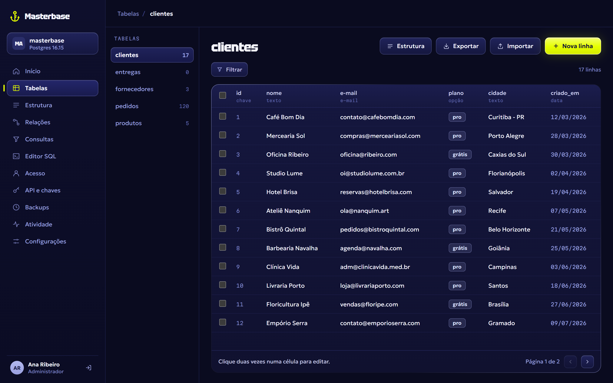
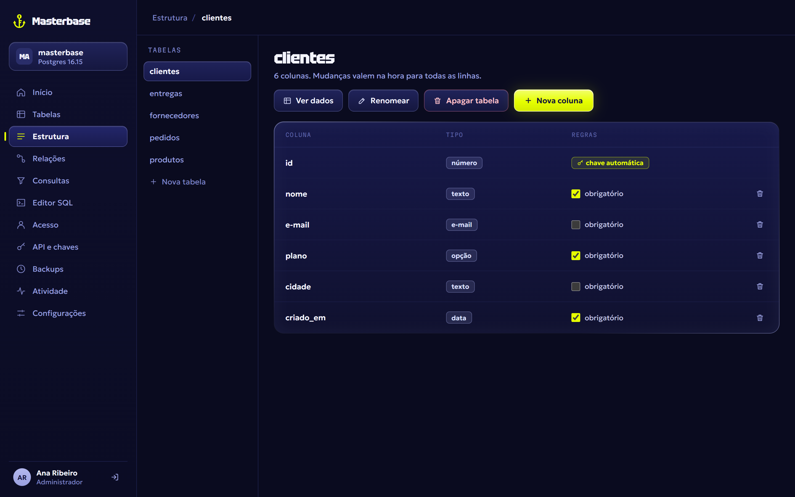
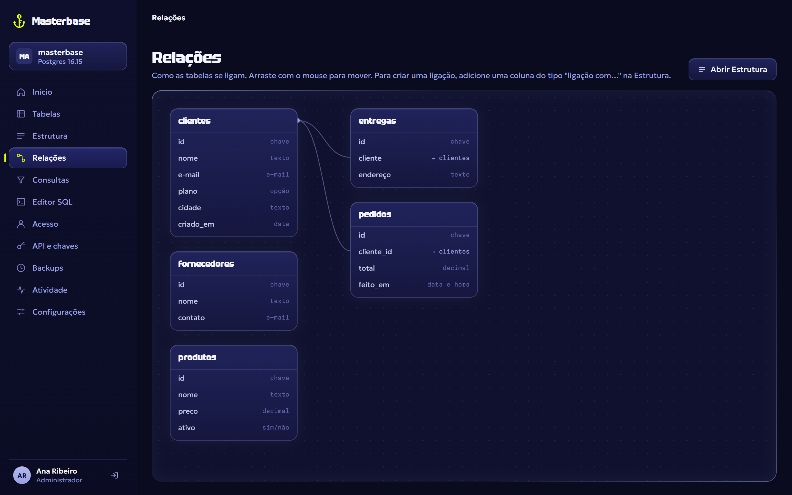
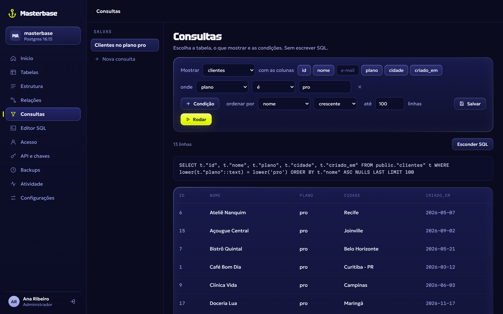
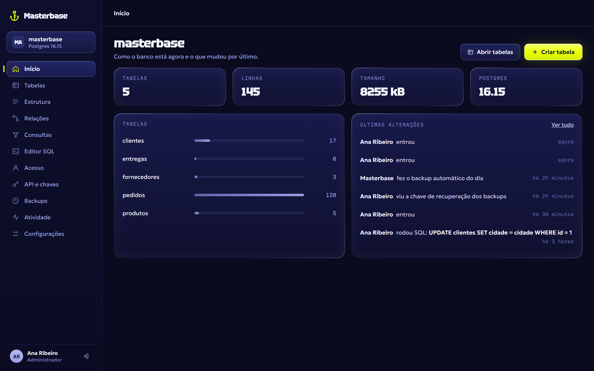

<p align="center">
  
</p>

<h1 align="center">Masterbase</h1>

<p align="center">
  Postgres com tela visual, para quem não sabe SQL.<br>
  Código aberto. Roda no seu servidor.
</p>

<p align="center">
  <a href="docs/guia-de-uso.md">Guia de uso</a> ·
  <a href="docs/instalacao.md">Instalação</a> ·
  <a href="docs/api.md">API</a> ·
  <a href="docs/integracao-ia.md">Integrar com IA</a> ·
  <a href="MVP.md">O que tem e o que falta</a>
</p>



O Masterbase fica na frente de um banco Postgres comum. Você cria tabelas, liga uma na outra, edita os dados como numa planilha e monta consultas escolhendo opções. O banco continua sendo Postgres de verdade: dá para conectar qualquer outra ferramenta nele quando precisar.

> **Estado do projeto:** versão 0.3. Funciona de ponta a ponta e tem testes, mas ainda não rodou em servidor de produção. Veja [o que falta](MVP.md#falta) antes de usar com dados importantes.

## O que dá para fazer

| | |
|---|---|
| **Tabelas** | Ver, filtrar, ordenar, editar célula com duplo clique, adicionar e apagar linhas, importar e exportar CSV. No celular, cada linha vira uma ficha. |
| **Estrutura** | Criar tabelas e colunas com tipos em português (texto, número, data, sim/não...). Valor padrão, troca de tipo, coluna obrigatória ou sem repetidos. |
| **Relações** | Ligar uma tabela a outra e ver o diagrama das ligações. |
| **Consultas** | Montar "mostrar clientes onde plano é pro" clicando. Ver o SQL gerado. Salvar para usar de novo. |
| **Editor SQL** | Para quem sabe SQL: ler e mudar dados com SQL, num acesso que não mexe na estrutura nem vê as contas. Só administradores. |
| **Acesso** | Três papéis: administrador, editor e leitor. Entrar com Google ou GitHub. Convite e "esqueci a senha" por e-mail, com link de uso único. |
| **API e chaves** | Chave para um site ou sistema ler e gravar nas tabelas. |
| **Backups** | Backup automático todo dia, criptografado, com limpeza dos antigos e cópia para outro disco ou nuvem. Baixar, restaurar e recuperar em outra máquina. |
| **Atividade** | Registro de quem mudou o quê e quando. |
| **Configurações** | Seu nome e senha, aparelhos conectados, tamanho do texto, nome da instância, duração da sessão e o endereço da documentação para IA. |

<table>
  <tr>
    <td></td>
    <td></td>
  </tr>
  <tr>
    <td></td>
    <td></td>
  </tr>
</table>

## Começar

Em Ubuntu, Debian ou macOS, cole no terminal:

```bash
curl -fsSL https://raw.githubusercontent.com/caioribi7/masterbase/main/install.sh | sh
```

O instalador coloca o Postgres (se faltar), cria o banco e instala o comando. Depois:

```bash
masterbase
```

O painel abre no navegador. Como o banco é novo, a primeira tela é o cadastro: **a primeira conta criada é a do administrador**. Depois dela, o cadastro fecha e novas pessoas entram pela página Acesso.

Para um servidor (acesso pela rede ou pela internet, HTTPS, ligar sozinho):

```bash
masterbase configurar         # porta e quem pode acessar
sudo masterbase servico       # liga junto com o servidor
```

O passo a passo completo está em [instalação](docs/instalacao.md).

| Comando | O que faz |
|---|---|
| `masterbase` | Abre o painel. Na primeira vez sem instalador, pergunta a configuração. |
| `masterbase configurar` | Muda banco, porta e quem pode acessar. |
| `masterbase servico` | Deixa rodando sozinho (Linux com systemd). |
| `masterbase chave-backup` | Mostra a chave que abre os backups. Guarde fora do servidor. |
| `masterbase recuperar ARQUIVO` | Restaura um backup no banco configurado, também num servidor novo. |
| `masterbase senha EMAIL` | Gera um link para criar senha nova, para quando ninguém consegue entrar. |
| `masterbase versao` | Mostra a versão. |

Enquanto roda, o terminal mostra uma linha por pedido e por mudança (quem fez, o quê, comandos do editor SQL). Dá para deixar o servidor parado num canto, usar pela rede e acompanhar tudo por ali.

O programa é um arquivo só, de uns 5 MB, com a tela dentro. Parado, usa uns 4 MB de memória.

## Integrar com outro sistema

Mande o arquivo [docs/integracao-ia.md](docs/integracao-ia.md) para uma IA (ChatGPT, Claude, Copilot) e peça o código. Ele descreve a API inteira, com exemplos. Todo Masterbase rodando também entrega esse texto em `/llms.txt`, então dá para passar só o endereço: `https://seu-masterbase/llms.txt`. A chave de API você cria na página API e chaves.

## Segurança

O Masterbase guarda dados dos outros, então isso vem primeiro:

- Senhas em argon2id. Sessão em cookie `HttpOnly`, `Secure`, `SameSite=Strict`. O banco guarda só o hash do token de sessão e das chaves de API.
- Cinco senhas erradas bloqueiam aquele e-mail por 15 minutos. Cada chave de API faz até 300 pedidos por minuto.
- O papel de cada pessoa é conferido no servidor em toda ação que escreve.
- Nenhum SQL é montado com texto digitado. Nomes de tabela e coluna são conferidos no catálogo do Postgres, tipos e operadores vêm de listas fixas, valores sempre vão como parâmetro.
- As contas e o histórico ficam num schema separado (`masterbase`), que a tela e a API não alcançam.
- Login com Google ou GitHub só para contas que já existem, com e-mail verificado no provedor. Links de e-mail usam sempre o endereço configurado (`MB_URL`).
- `unsafe` é proibido no código Rust.

Achou uma falha? Não abra issue pública. Veja [SECURITY.md](SECURITY.md).

## Como é feito

```
server/   Rust: Axum (HTTP) + sqlx (Postgres). Um binário, com a tela dentro.
web/      Svelte 5 + Vite. Vira arquivos estáticos que o servidor entrega.
dev/      Dados de exemplo e teste de ponta a ponta.
install.sh  Instalador de um comando.
docs/     Guias.
brand/    Logo e regras de interface.
```

O servidor não tem estado além do banco: as tabelas que você cria ficam no schema `public`, e o que é do Masterbase (contas, sessões, chaves, consultas salvas, atividade) fica no schema `masterbase`, criado sozinho na primeira subida.

## Desenvolver

Precisa de Postgres 16, Rust estável e Node 20+.

```bash
cd web && npm ci && npm run build                       # a tela vai para web/dist
cd server && DATABASE_URL=postgresql://... cargo run    # compila com a tela dentro
cd server && cargo test                                 # testes do servidor
cd web && npm run dev                                   # tela com recarga ao vivo em localhost:5173
bash dev/smoke.sh                                       # 178 checagens na API (banco novo com dev/seed.sql)
```

A página de apresentação fica em `site/` (React e Vite, fundo animado Flux Lines do [React Bits](https://reactbits.dev)): `cd site && npm ci && npm run dev`. O `npm run build` gera arquivos estáticos em `site/dist`, que servem em qualquer hospedagem.

Para publicar uma versão: `git tag v0.2.0 && git push origin v0.2.0`. O GitHub compila para Linux e macOS e publica em Releases, de onde o instalador baixa.

Leia [CONTRIBUTING.md](CONTRIBUTING.md) antes de mandar um pull request.

## Licença

[MIT](LICENSE). Grátis para qualquer uso, sem plano pago. Os [termos de uso](docs/termos-de-uso.md) explicam em português simples o que isso quer dizer.
